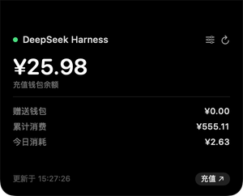
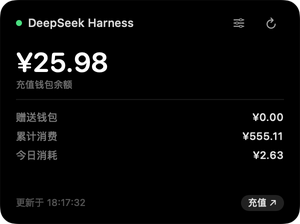
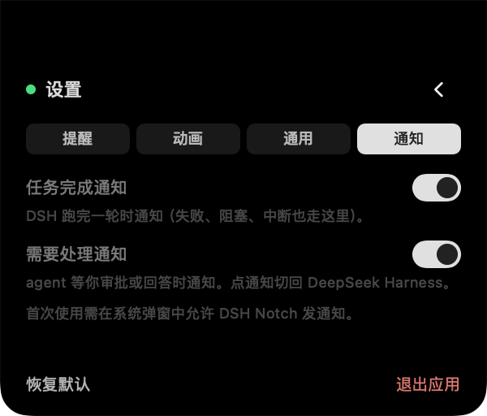

# DSHNotch

**A native macOS companion for DeepSeek Harness: your balance in the notch, system notifications when a task finishes or waits on you, and a live pill that shows which step the agent is on.**

[中文](README.md) · [Releases](https://github.com/hennysky/dsh-notch/releases) · [Engineering notes](docs/engineering-notes.md) · [DSH notification protocol](docs/dsh-notifications.md)


| Balance in the notch | Works without a notch | Notifications toggle separately |
|---|---|---|
|  |  |  |
| Click the notch to expand | Falls back to the menu bar | Two independent switches |

## What it does

- **Balance**: click the notch (or the menu bar item) to see your balance; it warns you when the balance drops below a threshold or a single lookup loses too much. The card has a **Top up ↗** button that opens the platform page in your browser.
- **DSH notifications**: a system notification when a task finishes, fails, or the agent stops to ask you something. Clicking it returns to DSH; the menu bar red dot stays until you open the card.
- **Starts with DSH**: install the companion plugin and the app comes up with DSH and translates session events into notifications.
- **Client enhancements**: a balance ring on the sidebar account row, Codex-style next-message predictions, a token-usage calendar, and the current session cost.
- **Run trace** (new in 1.8.0): one status pill under the composer showing what this step is doing, why, how long it has run and which step it is; click it for the step timeline of the current run.

> Status: v1.7.0 (menu bar app) · plugin 1.8.0 · MIT · macOS 14+ · Apple Silicon.
> Plugin tests and real notification delivery are both exercised.

## Install

### Requirements

| | |
|---|---|
| Hardware | Apple Silicon Mac (every MacBook with a notch is Apple Silicon) |
| OS | macOS 14.0 or later |
| Prerequisite | **DeepSeek Harness installed and signed in** — the balance comes from its credentials |

Without DSH the app shows a setup guide instead of a balance. It reads credentials from **your own machine** only.

### Download and install

Get `DSHNotch-x.y.z.zip` from [GitHub Releases](https://github.com/hennysky/dsh-notch/releases) or
[Gitee](https://gitee.com/hennysky/dsh-notch/releases), unzip it, and drag `DSHNotch.app` into Applications.

Or one command for the latest GitHub build:

```bash
curl -fL -o /tmp/DSHNotch.zip \
  https://github.com/hennysky/dsh-notch/releases/latest/download/DSHNotch.zip \
  && unzip -q -o /tmp/DSHNotch.zip -d /Applications \
  && xattr -dr com.apple.quarantine /Applications/DSHNotch.app \
  && open /Applications/DSHNotch.app
```

### Why the first launch needs right-click → Open

The app is not signed or notarized by Apple. Gatekeeper blocks unsigned apps, so a double click only says
"cannot be opened". Right-click → Open is a one-time approval. You can also clear the quarantine flag:

```bash
xattr -dr com.apple.quarantine /Applications/DSHNotch.app
```

## Using it

### Launch

The app has no Dock icon. A card icon appears in the menu bar so you can tell it is running:

| Action | Result |
|---|---|
| Left click | Expand the balance card |
| Right click | Menu: show card / refresh now / open top-up page / settings / launch at login / quit |

Hide the icon under Settings → General → Menu bar icon. Enable start at login under Settings → General.

### Two forms, chosen automatically

| Situation | Form |
|---|---|
| MacBook with a notch | Notch form: click the notch |
| Mac mini / iMac / external display only | Menu bar form: amount in the menu bar, click for the card |
| MacBook closed with an external display | Switches to the menu bar form, nothing is lost |

You can pin either form under Settings → General → Presentation.

### What the card shows

```
● DeepSeek Harness                    ⚙  ↻
¥20.75
Top-up wallet balance
────────────────────────────────
Bonus wallet                    ¥0.00
Total spent                   ¥555.11
Spent today                     ¥2.63
────────────────────────────────
Updated 15:23:57             [ Top up ↗ ]
```

- **Top up ↗** opens the platform page in your browser and reuses that browser session; no token is placed in the link.
- **↻** refreshes immediately. Opening the card already refreshes, with a 30-second floor so repeated opens stay polite.
- **⚙** opens settings.

### When it refreshes

| Trigger | Behaviour |
|---|---|
| Opening the card or the menu item | Immediate refresh |
| Background polling | Every 5 minutes |
| Manual ↻ | Immediate, no rate limit |

### Balance alerts

| Rule | Default | Behaviour |
|---|---|---|
| Balance below | ¥10 | Fires once when it crosses the threshold |
| Single drop above | ¥2 | Fires when two consecutive lookups differ by more |

Set a threshold to 0 to disable that rule. When both match, the low-balance alert wins.

### How "spent today" is computed

The platform API has no per-day breakdown, only a total. Spent-today is derived locally from a daily
baseline. When the baseline is unknown (first run, or after several days away) it never pretends to be zero:

| Baseline | Display | Meaning |
|---|---|---|
| Trusted | `¥2.63` | Exact |
| Untrusted, no delta yet | `统计中` | Waiting for the first delta |
| Untrusted, delta present | `≥¥2.63` | At least this much |

### Settings

The slider icon in the card header opens four pages: alerts (thresholds, dismiss delay), animation,
general (form, launch at login) and notifications.

### Quit / uninstall

Right-click the menu bar icon → Quit. To uninstall, delete `DSHNotch.app`. Settings live in the UserDefaults
domain `local.dsh.notch`; delete that too for a clean removal.

## Using it as a DSH plugin (recommended)

[`plugin/`](plugin/) is a DSH plugin. Installed into a profile it does four things:

1. **Lifecycle**: makes sure `DSHNotch.app` is running when DSH starts;
2. **Notification bridge**: turns task-end / approval / question events into system notifications;
3. **Client enhancements**: balance ring, predictions, usage calendar, session cost;
4. **Run trace** (1.8.0): the status pill and step timeline.

### Install from the plugin index

DSH 0.2.2+ supports index sources:

1. Open **Settings → Plugins → Discover → Index sources → Add**;
2. Paste `https://raw.githubusercontent.com/hennysky/dsh-notch/main/plugin-index.json`;
3. Find **DSH Notch** under Discover and install it;
4. Restart DeepSeek Harness.

Slow GitHub access? Use the Gitee mirror:
`https://gitee.com/hennysky/dsh-notch/raw/main/plugin-index.json`

### Manual install

```bash
DSH="/Applications/DeepSeek Harness.app/Contents/Resources/runtime/cli/bin/dsh"
"$DSH" plugin --profile desktop add /path/to/dsh-notch/plugin
```

Changes to the host half (`plugin/index.js`) need a DSH restart; `plugin/client.js` hot-reloads.

### Run trace (1.8.0)

Once the plugin is installed, DSH shows one status pill under the composer:

```
● Fix the column order in the export script · affects Excel    2:41 · step 12
```

- **Judgment line**: the plugin registers a short prompt asking the model to write `▸ action · reason`
  (at most 20 characters) before each tool call. The pill shows that line, so you can judge the direction
  before the work lands instead of after.
- **Right side**: elapsed time and the current step. Long lines are ellipsized; hover to read them in full.
- **Click**: the step timeline for this run, with the way to stop it at the bottom.
- **Brakes**: press <kbd>Esc</kbd> twice to stop the turn; typing in the composer steers instead of queueing.
- To turn it off, set `runTrace: false` in the plugin config.

## Where the data comes from

```
~/.dsh/.credentials.yaml          ← the platform authorization DSH saved locally
        ↓
GET {platform}/api/v0/users/get_user_summary
Header: x-dsh-auth-token: <token>
        ↓
normal_wallets / bonus_wallets / total_costs
```

- Credentials are never modified or uploaded. The token is sent to the DeepSeek platform only as the header of the balance request.
- The top-up link takes its origin from the same credentials and carries no token.
- A failed lookup keeps the last successful numbers and labels them stale; it never renders ¥0.00.
- Run trace reads local session state only and issues no extra model requests.

## FAQ

**Clicking the notch does nothing.** Make sure you hit the notch area itself (top edge, roughly the middle 193pt).
If it stays unresponsive, run the self test from the app menu and attach `/tmp/dsh-notch.log` to the issue
(start the app with `DSH_NOTCH_DEBUG=1` first).

**The status pill does not appear.** It only shows while the agent is running, and keeps `N steps this run`
for two minutes afterwards. Without a judgment line the prompt section probably did not register — restart
DSH or re-enable the plugin once.

**Does it send my token anywhere?** No. There are exactly two network requests: the balance lookup to the
DeepSeek platform, and the top-up page handed to your browser.

## Development

```bash
./build.sh                 # build build/DSHNotch.app
build/DSHNotch.app/Contents/MacOS/DSHNotch --selftest   # zero-manual self test
```

Plugin tests: `node plugin/test.mjs` (needs DSH runtime dependencies).

## License

MIT
