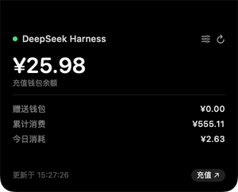
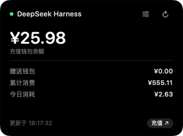
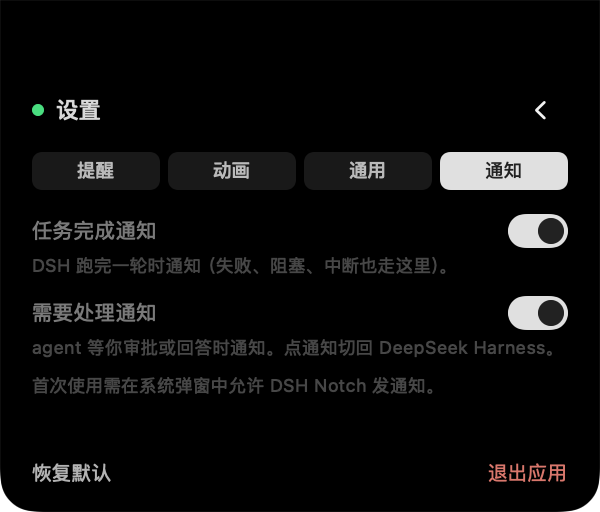
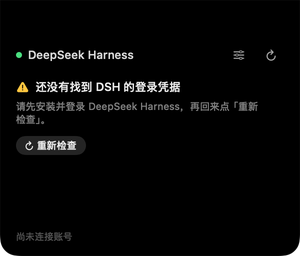
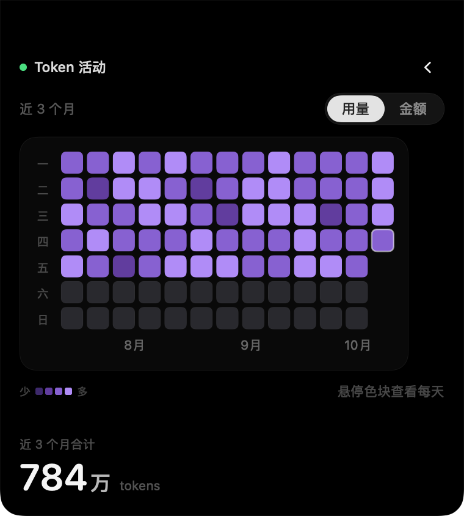

# DSHNotch

**A native macOS companion for DeepSeek Harness: balance in the notch, notifications when a task finishes or needs you.**

[中文](README.md) · [Download](https://github.com/hennysky/dsh-notch/releases) · [Engineering notes](docs/engineering-notes.md)
· [Notification protocol](docs/dsh-notifications.md)


| Balance in the notch | Works without a notch too | Notifications are switchable |
|---|---|---|
|  |  |  |
| Click the notch to expand | Falls back to the menu bar automatically | Task finished / needs attention, two switches |

Three things:

- **Balance**: click the notch (or the menu-bar item) to see the DeepSeek Harness balance; it alerts when the balance drops below a threshold or a single burn is unusually large.
- **DSH notifications**: macOS notifications when a task finishes, fails, or the agent stops for your approval or answer. Click to switch back to DSH; the banner disappears, but the **red dot on the menu bar does not** — until you open the card.
- **Starts with DSH**: one companion plugin launches it with DSH and bridges session events into notifications.

> Status: v1.6.9 (Windows 1.2.3 / plugin 1.6.1) · MIT · macOS 14+ · Apple Silicon — 14 human-free self-checks, plugin tests and real notification delivery all verified.

---

## What this is for

Your DSH balance is only visible inside the DSH app. While a long task is running,
you have no idea how much has been spent until you go look — and by then it is often nearly gone.
Long tasks have a second problem: when one finishes, or the agent stops for your approval,
you have no way to know unless you are looking at the window — DSH desktop has no system
notifications at all.

DSHNotch fixes both: the balance moves to the notch / menu bar, and it speaks up when the balance
is unusual, a task finishes, or the agent needs you.

The scope is deliberately narrow: **read-only balance and forwarding of DSH events. No message
sending, no top-up flow, no access to your account beyond what DSH already stores.**

---

## Installation

### Requirements

| | |
|---|---|
| Hardware | Apple Silicon Mac (every MacBook with a notch is Apple Silicon) |
| OS | macOS 14.0 or later |
| Prerequisite | **DeepSeek Harness installed and signed in** — the balance comes from its stored credentials |

> **Without DSH installed this tool is useless to you** — it shows the guidance page below
> instead of a balance. It reads the credentials on **your own machine**; it cannot see
> anyone else's data.



### Download

[GitHub Releases](https://github.com/hennysky/dsh-notch/releases) ·
[Gitee releases](https://gitee.com/hennysky/dsh-notch/releases) (faster from mainland China; assets currently at v1.7.5 — use GitHub for the latest icon fix)

Same-version packages are byte-for-byte identical on both platforms; Gitee assets currently stop at v1.7.5.

### One-line install

```bash
# GitHub
curl -fL -o /tmp/DSHNotch.zip \
  https://github.com/hennysky/dsh-notch/releases/download/v1.7.8/DSHNotch-1.6.9.zip \
  && unzip -q -o /tmp/DSHNotch.zip -d /Applications \
  && xattr -dr com.apple.quarantine /Applications/DSHNotch.app \
  && open /Applications/DSHNotch.app
```

```bash
# Gitee
curl -fL -o /tmp/DSHNotch.zip \
  https://gitee.com/hennysky/dsh-notch/releases/download/v1.7.5/DSHNotch-1.6.5.zip \
  && unzip -q -o /tmp/DSHNotch.zip -d /Applications \
  && xattr -dr com.apple.quarantine /Applications/DSHNotch.app \
  && open /Applications/DSHNotch.app
```

### Manual install

1. Download `DSHNotch-1.6.9.zip`
2. Unzip it and drag `DSHNotch.app` into `/Applications`
3. **The first launch must be right-click → Open** (see below)

### Why right-click → Open on first launch

The app is not signed with an Apple Developer ID and is not notarized (that costs $99/year).
Gatekeeper blocks unsigned apps, so a double-click just says "cannot be opened".
Right-click → Open is a one-time override; you will not be asked again.

If you prefer, drop the quarantine flag instead:

```bash
xattr -dr com.apple.quarantine /Applications/DSHNotch.app
```

That command removes the "downloaded from the internet" flag. The app never downloads anything:
it reads the credentials DSH already stored on this machine and calls DeepSeek's balance endpoint.

---

## Usage

### Launching

Drag `DSHNotch.app` into `/Applications` and double-click it (right-click → Open the first time).

**Or let it start together with DSH** — install the companion DSH plugin described in
"Using it as a DSH plugin" below.

Once running, **a card icon appears in the menu bar** — the app has no Dock icon and in notch
mode draws nothing on screen, so this icon is how you tell it is alive:

| Action | Result |
|---|---|
| **Left click** | Expand the balance card |
| **Right click** | Menu: show card / refresh now / top up / settings / launch at login / **Quit** |

Do not want it? Settings → General → Menu bar icon. (Menu bar mode does not need it —
its own item is the entry point.)

**Do not want to launch it manually?** Settings → General → Launch at login. Verified working.

### First launch: you need DSH connected

The balance comes from the login credentials DSH stores. If they are not there yet
(DSH not installed, or installed but not signed in), the card tells you what to do:

| Situation | What the card shows |
|---|---|
| No credentials file | "No DSH login credentials found yet" + how to install and sign in |
| Credentials present but no login record | "DSH is not signed in" + how to sign in |
| Anything else (network, rate limit) | The normal error line — **never** mistaken for setup |

Sign in and press "Check again"; no need to restart the app.

### Two modes, chosen automatically

**There is nothing to pick during installation, and you do not need to know whether your Mac
has a notch.** The app decides at runtime and re-decides whenever your displays change:

| Situation | Mode |
|---|---|
| MacBook with a notch | **Notch mode** — click the notch to expand the card |
| Mac mini / iMac / external display only | **Menu bar mode** — balance in the menu bar, click to open the card |
| MacBook in clamshell with an external display | Switches to menu bar mode automatically; **nothing is lost** |

You can also pin one mode in Settings: Auto / Notch only / Menu bar only.

### What the card shows

```
● DeepSeek Harness                    ⚙  ↻
¥20.75
Recharge wallet balance
────────────────────────────────
Bonus wallet                    ¥0.00
Total spent                    ¥555.11
Spent today                     ¥2.63
────────────────────────────────
Updated 15:23:57            [ Top up ↗ ]
```

- **Top up ↗** opens the platform's top-up page in your browser, using the browser's own
  session. The link carries no token.
- **↻** forces a refresh
- **⚙** opens Settings

### When the balance refreshes

| Trigger | Behaviour |
|---|---|
| **Opening the card / menu bar item** | **Refreshes immediately — what you see is current** |
| Background polling | Every 5 minutes |
| Clicking ↻ | Immediate, no throttle |

Opening the card is throttled to at most once every 30 seconds — otherwise clicking repeatedly
would hit the platform's rate limit.

### Balance alerts

The balance is hidden behind the notch, so there are two rules that speak up on their own:

| Rule | Default | Behaviour |
|---|---|---|
| **Balance below** | ¥10 | Fires once, at the moment it crosses the line |
| **Single burn above** | ¥2 | Fires when the drop between two polls is large |

- Set a threshold to **0 to disable that rule**
- When both fire, the low-balance one wins
- **Notch mode**: the card pops out by itself and retracts after a few seconds
- **Menu bar mode**: the menu bar title turns into the alert (`¥5.74 → ⚠ ¥5.74`) —
  it will not interrupt what you are doing
- Any click from you takes over immediately

> Why does "balance below" fire only once? Because polling runs every 5 minutes; alerting on
> "is currently low" would mean a popup every 5 minutes. Recharging above the threshold re-arms it.

### DSH notifications (v1.4)

The DSH desktop app has no system notifications of its own: when a task finishes, or when the
agent stops and waits for approval, you have no way to know unless you are looking at the window.
With the companion plugin ([`plugin/`](plugin/), v1.6.1+) these events become macOS
notifications from DSHNotch:

| When | Notification |
|---|---|
| A DSH turn finishes | "任务完成" with the session name and elapsed time |
| The turn fails / is blocked / hits the length limit | the matching title, with the error message on failure |
| The agent waits for approval | "需要你确认" with the tool name and reason |
| The agent asks a question | "需要你回答" with the question text |

- **Clicking a notification switches back to DeepSeek Harness** (launching it if it is not running)
- **Banners disappear, the red dot does not**: a new notification puts a red dot on the menu bar
  icon (in menu bar mode, after the amount as `●`) and it stays until you open the card or click
  the notification — so being away from the screen no longer means missing it for good
- macOS asks for notification permission once; you can revoke it in System Settings → Notifications
  → DSH Notch, or turn off "task finished" / "needs attention" separately in the card's
  **Notifications** page
- Turns you cancelled yourself are not announced (you already know); subagent turns are not
  announced separately
- Notifications carry DSHNotch's own identity — not "Script Editor"

How it works: the plugin listens to session events inside DSH → `POST 127.0.0.1:47810/notify` →
DSHNotch delivers through `UNUserNotificationCenter`. The listener binds loopback only; when the
plugin is missing or not loaded, the rest of DSHNotch is unaffected. Protocol and design:
[docs/dsh-notifications.md](docs/dsh-notifications.md) (Chinese).

If a notification does not appear, check in this order:

```bash
curl -s http://127.0.0.1:47810/health
# {"app":"DSHNotch","authorization":"authorized","ok":true,"version":"1.4"}

grep 通知 "$(node -e 'process.stdout.write(require("os").tmpdir())')/dsh-notch-plugin.log"
```

| Symptom | Cause |
|---|---|
| curl cannot connect | DSHNotch is not running (or another instance holds the port) |
| `authorization` is not `authorized` | notification permission is off |
| No "已注册 3 个监听" in the log | the plugin is still the old version: restart DSH once |
| `HTTP 200 … shown:false` in the log | the matching toggle is off in the card settings |

### Token activity calendar

A calendar button in the card header enlarges the same card to 380×390 and opens a 3-month
heatmap of daily token usage, or of estimated cost (tokens are purple, money is green). Hover a cell to see that day's exact
numbers.

 The plugin aggregates session logs per day (first backfill may take tens of seconds,
then incremental); it only reads `~/.dsh/notch/token-activity.json` locally. Details:
[docs/token-activity.md](docs/token-activity.md).

### Current session cost

With the plugin installed (1.6.1+), the card gains a **current session** section: how many tokens the
DSH session you are looking at used, and an estimated cost at the official rates (e.g. `≈¥0.42`,
labelled as an estimate; the platform bill is authoritative).

- Tokens come from the DSH session log and are exact; the money is an estimate using the
  official peak / off-peak rates. Only `~/.dsh/notch/session-cost.json` is read locally — no
  network calls, no conversation content. Details: [docs/session-cost.md](docs/session-cost.md)

### Settings

Click the slider icon in the card header. Four pages:

| Page | Contents |
|---|---|
| **Alerts** | Low-balance threshold, single-burn threshold, how long alerts stay up |
| **Animation** | Expand/collapse duration and easing curve |
| **General** | Presentation mode, launch at login |
| **Notifications** | Task-finished notifications, needs-attention notifications (sent by the DSH plugin) |

Changes take effect immediately and are remembered.

### Quit / uninstall

| | |
|---|---|
| **Quit** | Right-click the menu bar icon → Quit (or click the notch → slider icon → "Quit") |
| **Launch at login** | Settings → General → Launch at login |
| **Uninstall** | Delete `DSHNotch.app`. Preferences live in the UserDefaults domain `local.dsh.notch`; delete that too for a clean removal |

---

## Using it as a DSH plugin (optional)

If DeepSeek Harness is always running, you can have the notch widget **start together with DSH**
instead of launching it by hand.

[`plugin/`](plugin/) is a DSH plugin. Once installed into a profile it does two things:

1. **Lifecycle**: DSH starts → the plugin activates → it makes sure `DSHNotch.app` is running;
2. **Notification bridge** (v1.1.0+): it POSTs DSH's turn-finished / approval / question events
   to DSHNotch, which turns them into macOS notifications (see "DSH notifications" above).

> **Windows has its own tray companion**: download and run [DSHNotch-Setup-1.2.3.exe](https://github.com/hennysky/dsh-notch/releases/download/v1.7.8/DSHNotch-Setup-1.2.3.exe) — it installs
> into `%LOCALAPPDATA%\Programs\DSHNotch` with a Start Menu shortcut (no unzip, no command line);
> the plugin (v1.3.0+) detects and launches it. The Gitee release also carries the Windows
> installer: https://gitee.com/hennysky/dsh-notch/releases/tag/v1.7.5
> Without the tray app it falls back to DeepSeek
> Harness's own Electron notifications, then to a PowerShell toast. Source lives in
> [`windows/`](windows/); see [plugin/README.md](plugin/README.md).

```bash
DSH="/Applications/DeepSeek Harness.app/Contents/Resources/runtime/cli/bin/dsh"
"$DSH" plugin --profile desktop add /path/to/dsh-notch/plugin
# restart DeepSeek Harness to activate
```

Verify:

```bash
cat "$(node -e 'process.stdout.write(require("os").tmpdir())')/dsh-notch-plugin.log"
# [..] 已随 DSH 启动：/Applications/DSHNotch.app
# [..] 通知：已注册 3 个监听（桥端口 47810）
```

Launch behaviour: starts the app when it is not running; does nothing when it is already running
(so a second notch window is never drawn); and skips quietly when the app is not where it is
expected. **Plugin code changes need a DSH restart** — Host plugins are not hot-reloaded like the
Web UI.

### Why the plugin does not move the UI into DSH

The notch overlay needs a window level above the menu bar, no border, a non-activating panel,
and exclusion from Exposé and window cycling. Only a native `NSWindow` can do that — an Electron
`BrowserWindow` cannot reach that level. So the plugin owns the **lifecycle** while
`DSHNotch.app` keeps owning the UI.

See [plugin/README.md](plugin/README.md) (Chinese).

## Where the data comes from

```
~/.dsh/.credentials.yaml          ← the platform grant DSH stored on this machine
        ↓
GET {platform}/api/v0/users/get_user_summary
Header: x-dsh-auth-token: <token>
        ↓
normal_wallets / bonus_wallets / total_costs
```

- **Your credentials are never modified or uploaded.** The token is sent only as a header to
  DeepSeek's own balance endpoint.
- The top-up link is derived from the same credential, and **carries no token**
- On a failed query the app **keeps the last successful data** and labels it — it never
  manufactures a ¥0.00
- Amount fields accept both shapes the platform uses (decimal strings and JSON numbers)

### How "spent today" is computed

The platform API **has no per-day dimension** — it only exposes cumulative spend (`total_costs`).
So "spent today" is reconstructed locally: record the cumulative value at the start of the day,
and take the difference.

When the day's starting point is unknown (first run, or the app was closed for days),
the app does **not** show ¥0.00 — that would disguise "unknown" as "nothing spent":

| Baseline | Shown | Meaning |
|---|---|---|
| Reliable | `¥2.63` | Exact |
| Unreliable, no increase yet | `统计中` (counting) | Waiting for the first increase |
| Unreliable, some increase | `≥¥2.63` | At least this much |

It becomes exact from the next day onward.

---

## FAQ

**Clicking the notch does nothing.**
Make sure you are actually hitting the notch region (the top edge of the screen, roughly the
middle 193pt). If it stays unresponsive, run the self-checks below and attach
`/tmp/dsh-notch.log` to an issue (start the app with `DSH_NOTCH_DEBUG=1` first).

**Why does "spent today" say `统计中`?**
See the section above. It is the honest display when no reliable baseline exists yet.

**Does it send my token anywhere?**
No. There are exactly two network operations: the balance query (to DeepSeek's platform) and
opening the top-up page (handed to your browser; the link contains no token). Nothing is reported
anywhere else.

**Can I send this to a friend?**
Yes — as long as **they also use DSH and are signed in**. The app reads
`~/.dsh/.credentials.yaml` on their own machine and cannot see your data. Exactly one
domain is hard-coded (`platform.deepseek.com`); nothing is sent anywhere else.

One caveat: a package delivered via chat apps, AirDrop, or a browser download carries the
"downloaded from the internet" flag, so **Gatekeeper will always block the first launch** —
right-click → Open is required. Sending them the `curl` one-liner from this README is easier:
`curl` does not set that flag.

**Does it work on Intel Macs?**
No — arm64 only. Every MacBook with a notch is Apple Silicon.

**There is no icon in my menu bar.**
Settings → General → Presentation mode. If it is pinned to "Notch only" but the current screen
has no notch, the app falls back to menu bar mode and logs a line.

---

## Self-checks

The project ships 14 self-checks, **none of which require eyes** — the development environment
has no screen-recording permission, so every claim has to be verifiable by command:

```bash
BIN=/Applications/DSHNotch.app/Contents/MacOS/DSHNotch

$BIN --selftest        # credentials + API call + parsing
$BIN --modecheck       # mode resolution: notch / menu bar / clamshell / forced
$BIN --refreshcheck    # refresh policy: the 30-second throttle boundary
$BIN --alertcheck      # alert rules: 8 threshold scenarios
$BIN --costcheck       # "spent today": day rollover, gaps, bad values
$BIN --settingscheck   # settings persistence
$BIN --logincheck      # launch at login: can a login item be registered (reverts after)
$BIN --setupcheck      # first-run guidance: classification of missing/signed-out credentials
$BIN --panelcheck      # window placement + layer above the menu bar
$BIN --clicktest       # click path + hit testing + content pixels + mid-animation sampling
$BIN --notifycheck     # notification bridge protocol: /health, /notify, dedupe, truncation, error codes
$BIN --sessioncostcheck
$BIN --calendarcheck
$BIN --unreadcheck     # unread badge: counting / clearing / the icon really contains red pixels
```

Two extra switches for debugging display issues:

```bash
DSH_NOTCH_DEBUG=1 $BIN      # log state changes, actual window frames, window-server layers
DSH_NOTCH_TEST_ALERT=3 $BIN # simulate an alert 3 seconds after launch
```

---

## Known limitations

1. **Not signed or notarized.** First launch needs right-click → Open.
2. **The API is rate limited.** HTTP 429 was hit during development; that is why opening the
   card is throttled to once per 30 seconds.
3. **Launch at login has caveats for unsigned distribution.** Verified working with an ad-hoc
   signature (`--logincheck`), but the app really needs to live in `/Applications` for it to make
   sense. If macOS refuses, the setting reverts to the actual state; you can always add it
   manually in System Settings → General → Login Items.
4. **Window layering in full-screen and multi-display setups has not been visually verified.**
5. **"Spent today" is reconstructed locally** — the platform has no per-day data.
6. **arm64 only.**
7. **The credentials come from a DSH-internal file** whose format may change between DSH
   versions. A parse failure produces a clear error rather than a silently wrong number.
8. **Notifications require plugin v1.1.0+.** Plugin code is loaded when DSH starts, so restart DSH
   once after upgrading the plugin; upgrading DSHNotch itself does not need a DSH restart.
9. **Notifications cover root sessions only**: subagent turns are not announced, and turns you
   cancelled yourself are silent by default.
10. **Focus / Do Not Disturb suppresses banners** (they still land in Notification Centre,
    depending on system settings) — that is macOS behaviour.
11. **Clicking a notification only activates DSH, not a specific session**: DSH's local port
    changes on every launch, so deep links are out of scope for now.

---

## Development

```bash
git clone https://github.com/hennysky/dsh-notch.git
cd dsh-notch
./build.sh      # → build/DSHNotch.app
./release.sh    # → dist/DSHNotch-x.y.zip
```

A Swift toolchain is required. **The deployment target must be set explicitly** — without it the
build inherits the toolchain default and stamps `LC_BUILD_VERSION` with the current OS version,
producing a package nobody can run. `toolchain.sh` pins it.

Architecture and the reasoning behind implementation choices are in the
[engineering notes](docs/engineering-notes.md) (Chinese).

---

## License

[MIT](LICENSE)
