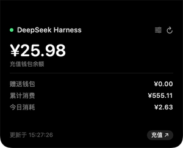
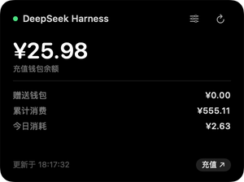
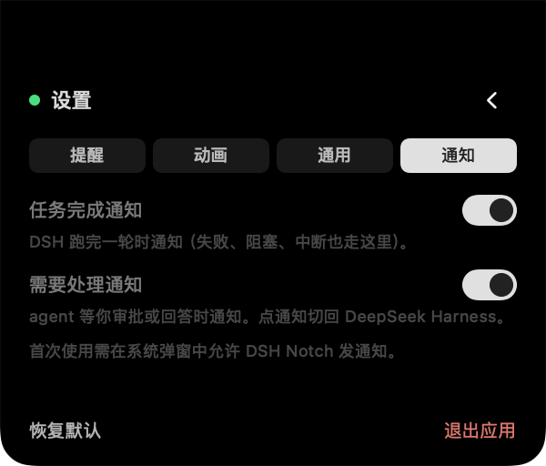

# DSHNotch

**DeepSeek Harness 的 macOS 原生伴侣：刘海看余额，任务完成 / 等你处理时发系统通知，桌面端还能看见它现在跑到第几步。**

[English](README.en.md) · [下载](https://github.com/hennysky/dsh-notch/releases) · [工程笔记](docs/engineering-notes.md) · [DSH 通知协议](docs/dsh-notifications.md)


| 余额就在刘海里 | 没有刘海的 Mac 也能用 | 通知可以分别关 |
|---|---|---|
|  |  |  |
| 点刘海展开卡片 | 自动用菜单栏形态 | 任务完成 / 需要处理，两个开关 |

## 它做五件事

- **余额**：点刘海（或菜单栏）看余额；跌破阈值、单次消耗过大时主动提醒。卡片里有「充值 ↗」，用系统浏览器打开平台充值页。
- **DSH 通知**：任务完成、失败、或 agent 停下来等你审批／回答时发 macOS 系统通知。点通知切回 DSH；横幅消失后菜单栏图标上的红点保留到你看过为止。
- **跟着 DSH 启动**：装配套插件后 DSH 启动时自动拉起，并负责把会话事件转成通知。
- **客户端增强**：侧栏账号行余额环、输入框 Codex 式下一句预测、Token 用量日历、当前会话花费。
- **执行过程跟踪**（v1.8.0 新增）：DSH 输入框下方一行状态条，显示这一步在做什么、为什么、已用多久、第几步；点开是本次运行的步骤时间线。

> 状态：v1.7.0（菜单栏应用）· 插件 1.8.0 · MIT · macOS 14+ · Apple Silicon
> 插件测试与真实通知投递均已实测。

## 安装

### 要求

| | |
|---|---|
| 机型 | Apple Silicon 的 Mac（带刘海的 MacBook 全部是 Apple Silicon） |
| 系统 | macOS 14.0 或更高 |
| 前置 | **已安装并登录 DeepSeek Harness**——余额数据来自它的登录凭据 |

没有装 DSH 的话这个工具对你没用，它会显示引导页而不是余额。应用读取的是**你自己机器上**的凭据。

### 下载并安装

从 [GitHub Releases](https://github.com/hennysky/dsh-notch/releases) 或
[Gitee 发行版](https://gitee.com/hennysky/dsh-notch/releases) 下载 `DSHNotch-x.y.z.zip`，解压后把
`DSHNotch.app` 拖进「应用程序」。

一条命令装 GitHub 最新版：

```bash
curl -fL -o /tmp/DSHNotch.zip \
  https://github.com/hennysky/dsh-notch/releases/latest/download/DSHNotch.zip \
  && unzip -q -o /tmp/DSHNotch.zip -d /Applications \
  && xattr -dr com.apple.quarantine /Applications/DSHNotch.app \
  && open /Applications/DSHNotch.app
```

### 为什么首次要「右键 → 打开」

应用没有 Apple 开发者签名与公证。macOS 的 Gatekeeper 会拦下未签名应用，双击只会看到「无法打开」。
「右键 → 打开」是一次性放行，之后不再提示；也可以直接去掉隔离标记：

```bash
xattr -dr com.apple.quarantine /Applications/DSHNotch.app
```

## 使用

### 启动

应用不占 Dock。启动后菜单栏有一个卡片图标，用来确认它在运行：

| 操作 | 效果 |
|---|---|
| 左键 | 展开余额卡片 |
| 右键 | 菜单：显示卡片 / 立即刷新 / 打开充值页 / 设置 / 开机自启 / 退出 |

不想看到图标：设置 → 通用 → 菜单栏图标。想在开机时自动启动：设置 → 通用 → 开机自启。

### 两种形态，自动选

| 场景 | 形态 |
|---|---|
| MacBook 有刘海 | 刘海形态：点刘海展开卡片 |
| Mac mini / iMac / 纯外接屏 | 菜单栏形态：菜单栏显示金额，点开是卡片 |
| MacBook 合盖接外屏 | 自动切到菜单栏形态，功能不丢 |

有刘海也可以强制用菜单栏形态，反之亦然：设置 → 通用 → 呈现形态。

### 卡片里有什么

```
● DeepSeek Harness                    ⚙  ↻
¥20.75
充值钱包余额
────────────────────────────────
赠送钱包                        ¥0.00
累计消费                      ¥555.11
今日消耗                        ¥2.63
────────────────────────────────
更新于 15:23:57              [ 充值 ↗ ]
```

- **充值 ↗**：系统浏览器打开平台充值页，沿用那边的登录态，链接不带任何 token
- **↻** 立即刷新（点开卡片本身也会先刷新一次；30 秒内不重复请求）
- **⚙** 设置

### 什么时候刷新

| 触发 | 说明 |
|---|---|
| 点开卡片 / 菜单栏 | 立刻刷新，看到的就是当下余额 |
| 后台轮询 | 每 5 分钟 |
| 手动 ↻ | 立即刷新，不受限制 |

### 额度提醒

| 规则 | 默认 | 行为 |
|---|---|---|
| 余额低于 | ¥10 | 跌破那一刻提醒一次 |
| 单次消耗超过 | ¥2 | 相邻两次查询之间掉得太多就提醒 |

阈值设为 0 即关闭该规则；两条同时命中时余额告急优先。

### 今日消耗是怎么算的

平台接口没有按天维度，只提供累计消费。今日消耗由本地推算：记录每天起点的累计值作为基线，用差值算。
当天起点无从得知时（首次运行、或隔了多天才开应用）不会显示成 `¥0.00`：

| 基线 | 显示 | 含义 |
|---|---|---|
| 可信 | `¥2.63` | 精确值 |
| 不可信，尚无增量 | `统计中` | 等第一次增量 |
| 不可信，已有增量 | `≥¥2.63` | 至少这么多 |

### 设置

卡片右上角滑杆图标进入设置，分四页：提醒（阈值、停留时长）、动画、通用（形态、开机自启）、通知。

### 退出 / 卸载

菜单栏图标右键 → 退出；卸载直接删掉 `DSHNotch.app`。配置存在 UserDefaults 域 `local.dsh.notch`，
想彻底清干净一并删除。

## 作为 DSH 插件使用（推荐）

仓库里的 [`plugin/`](plugin/) 是一个 DSH 插件。装进 profile 后它做四件事：

1. **生命周期**：DSH 启动时确保 `DSHNotch.app` 在跑；
2. **通知桥**：把任务结束 / 审批 / 提问事件转成系统通知；
3. **客户端增强**：账号行余额环、输入预测、用量日历、当前会话花费；
4. **执行过程跟踪**（1.8.0）：底部状态条 + 步骤时间线。

### 从插件索引安装

DSH 0.2.2+ 支持添加索引源：

1. 打开 **设置 → 插件 → 发现 → 索引源 → 添加**；
2. 粘贴 `https://raw.githubusercontent.com/hennysky/dsh-notch/main/plugin-index.json`；
3. 回到「发现」，找到 **DSH Notch** → 安装；
4. 重启 DeepSeek Harness 生效。

国内访问 GitHub 慢时用 Gitee 镜像：
`https://gitee.com/hennysky/dsh-notch/raw/main/plugin-index.json`

### 手动安装

```bash
DSH="/Applications/DeepSeek Harness.app/Contents/Resources/runtime/cli/bin/dsh"
"$DSH" plugin --profile desktop add /path/to/dsh-notch/plugin
```

改 Host 侧插件代码（`plugin/index.js`）要重启 DSH；只改 `plugin/client.js` 会热更新。

### 执行过程跟踪（1.8.0）

装上插件后，DSH 输入框下方会多一行状态条：

```
● 修复导出脚本的列顺序 · 影响 Excel    2:41 · 第 12 步
```

- **判断行**：插件向模型注册一段提示，要求每步工具调用前写一行 `▸ 动作 · 理由`（不超过 20 字）。
  状态条显示的就是这一行，所以你能在它动手前判断方向对不对，而不是等它跑完。
- **右侧**：已用时间和当前步数；超过宽度时判断句变省略号，悬停看全文。
- **点开**：本次运行的步骤时间线（谁在第几步做了什么），底部写着刹车方式。
- **刹车**：连按两次 <kbd>Esc</kbd> 停止本轮；在输入框打字是插话纠错，不是排队。
- 关掉它：插件配置里设 `runTrace: false`。

## 数据从哪来

```
~/.dsh/.credentials.yaml          ← 本机 DSH 保存的平台授权
        ↓
GET {platform}/api/v0/users/get_user_summary
Header: x-dsh-auth-token: <token>
        ↓
normal_wallets / bonus_wallets / total_costs
```

- 不改动、不上传凭据。token 只在请求余额接口时作为请求头发给 DeepSeek 平台
- 充值链接的域名取自同一份凭据，链接里不携带任何 token
- 查询失败时保留上一次成功的数据并标注，绝不显示成 ¥0.00
- 执行过程跟踪只读本地会话状态，不产生额外的模型请求

## 常见问题

**点了刘海没反应？** 确认真的点到了刘海区域（屏幕最上沿、中间约 193pt）。长期无响应时跑一次自检
（应用菜单里的「自检」），并把 `/tmp/dsh-notch.log` 附在 issue 里（需先用 `DSH_NOTCH_DEBUG=1` 启动）。

**状态条不出现？** 只有 agent 正在跑时才显示。跑完 2 分钟内保留「本次 N 步」，之后自动收起。
没有判断句一般是提示词段没生效——重启 DSH 或重新启用一次插件。

**会不会把 token 传到别的地方？** 不会。只有两个网络请求：查余额（发给 DeepSeek 平台）、
打开充值页（交给系统浏览器）。

## 开发

```bash
./build.sh                 # 构建 build/DSHNotch.app
build/DSHNotch.app/Contents/MacOS/DSHNotch --selftest   # 零人工自检
```

插件侧测试：`node plugin/test.mjs`（需要 DSH 的运行时依赖）。

## 协议

MIT
