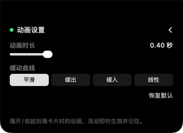

# dsh-notch

**v0.1** — 在 MacBook 刘海区显示 DeepSeek Harness 余额。

点击刘海展开卡片，再点收起。卡片内置动画参数设置。

| 余额页 | 动画设置页 |
|---|---|
|  |  |

> 上面两张图是应用自己离屏渲染出来的真实内容，不是设计稿。左图右上的滑杆图标进入右图。

- 平台：macOS 13+（在 MacBook Pro 18,3 / macOS 27 上开发和验证）
- 构建：`./build.sh`
- 自检：`--panelcheck` / `--clicktest` / `--settingscheck` / `--selftest`，详见下文
- 协议：MIT，见 [LICENSE](LICENSE)

## 它解决什么问题

DSH 的余额只在应用界面里看得到。这个工具把余额搬到刘海——不占桌面空间，
点一下就能看到，尤其适合挂着长任务时瞄一眼余额。

功能刻意做得很窄：**只读余额，不做充值、不做历史、不碰账号**。

## 验证记录

`--selftest` 实测输出（真实账号）：

```
✓ 凭据读取成功（~/.dsh/.credentials.yaml）
✓ 接口调用成功
  充值钱包  ¥25.98
  赠送钱包  ¥0.00
  累计消费  ¥540.15
```

自洽性检查：同一次会话开始时读到的是「余额 ¥28.61 / 累计消费 ¥537.52」，
之后是「¥25.98 / ¥540.15」——余额减少 2.63，消费增加 2.63，**两者完全相等**，
说明字段映射正确（`normal_wallets` 确为充值钱包、`total_costs` 确为累计消费）。

开发期间踩到的两个真实坑，均已修正并写进代码注释：

1. **`code` / `biz_code` 是 JSON 数字 `0`，不是字符串 `"0"`** —— 最初按 String 解码导致整次解析失败。
   现在用 `LooseString` 统一兼容字符串与数字两种形态。
2. **接口有频率限制** —— 连续请求会返回 HTTP 429，已单独处理并给出友好提示。


## 快速开始

```bash
./build.sh                       # 构建 build/DSHNotch.app
./build/DSHNotch.app/Contents/MacOS/DSHNotch --selftest   # 只验证取数，不弹窗
open build/DSHNotch.app          # 启动（常驻，无 Dock 图标）
```

退出：`pkill -f DSHNotch`

## 交互设计

点击触发，不用 hover。

- **折叠态（默认）**：**什么都不画**。刘海保持原样，窗口 = 刘海矩形左右各外扩 4pt
  （本机 193×32pt），不占用菜单栏以外的任何区域。外扩是为了覆盖窗口对齐 2x 像素网格的
  取整误差，也让 185×32pt 的窄目标更容易点中。
- **点击刘海带** → 卡片从屏幕顶端向下展开成 300×218pt 的黑色卡片，顶部与刘海连成一体、
  底部圆角。显示充值钱包余额、赠送钱包、累计消费、更新时间，右上角可手动刷新。
- **再点一次刘海带 / 点卡片外面** → 收起。收起后窗口缩回刘海那 193×32pt，不再画任何东西。
- 状态色：≥¥10 绿 / ≥¥1 橙 / <¥1 红 / 查询失败灰。

### 为什么不用 hover

先做过 hover 版本（`NSTrackingArea`，后又改成 80ms 轮询鼠标位置），能用但体验脆：
鼠标扫过刘海就会闪一下、手一抖卡片就没了，而且"到底算不算移出"很难界定——
卡片底边在 y=764，鼠标从刘海（y=982）往下划过 764 就直接收起，整个过程常常不到一秒。

点击是显式意图，没有歧义，也不需要常驻轮询。触发点就在刘海那一条上，开和关是同一个手势。

窗口行为：层级 `NSWindow.Level.statusBar + 1`（高于菜单栏）、`.nonactivatingPanel`
（点击不会抢走当前应用的焦点）、`canJoinAllSpaces` + `fullScreenAuxiliary`（切换
桌面、全屏应用时依然可见）。

## 第三个坑（最贵的一个）：内容比窗口慢一拍

### 症状

窗口 frame、层级、位置**全部正确**，自绘位图却是 **0 个非透明像素**——
窗口在那儿，里面是空的，所以屏幕上什么也看不到。

### 根因

`@Published` 是在 **willSet 阶段**发布的：订阅回调被调用时，属性**还没有真正写入**。

```swift
model.$isExpanded
    .sink { [weak self] expanded in self?.applyExpansion(expanded) }   // 此刻 model.isExpanded 还是旧值
```

而 `NSHostingView` 手工托管的视图树，`@ObservedObject` 的更新传播并不可靠——
在回调里重建视图树时读 `model.isExpanded`，拿到的是**上一个状态**，于是内容永远慢一拍。
`--clicktest` 把这个现象抓得很清楚：

```
✓ 折叠态不画任何东西        非透明像素 0
✗ 点击后卡片出现且有内容     非透明像素 0        ← 点开是空的
✗ 再次点击后卡片收起         非透明像素 1552     ← 再点一次才画出上一状态
```

### 修复

两条一起用：

1. **展开状态显式传进视图**，不让视图自己去读：

```swift
struct NotchRootView: View {
    let isExpanded: Bool        // 由控制器传入，不读 model.isExpanded
    ...
}
```

2. **内容刷新改到下一个 runloop 周期**，等属性真正落定后再重建视图树：

```swift
model.objectWillChange
    .sink { [weak self] in DispatchQueue.main.async { self?.refreshContent() } }
```

### 教训

**窗口正确 ≠ 内容正确。** 这次三层 bug 叠在一起：层级对了、位置对了、状态机也对了，
但窗口里是空的。判断"到底显示了什么"必须看**内容本身**——
`opaquePixelCount()` 数窗口的非透明像素，是唯一能自动化验证这件事的办法。

## 动画参数（卡片内可调）

卡片右上角的滑杆图标进入设置页：

- **动画时长** 0.1 – 1.5 秒（默认 0.45，原先用系统默认约 0.2 秒，偏快）
- **缓动曲线** 平滑 / 缓出 / 缓入 / 线性
- **恢复默认**

改动即时生效，写入 `UserDefaults`（key: `dshNotch.animationDuration` / `dshNotch.easing`），重启后保留。

### 展开与收起必须分别处理内容时机

内容状态（`contentExpanded`）要**故意滞后于**窗口状态：

- **展开**：内容立刻置为展开，由窗口动画把它「拉」出来
- **收起**：内容留到**动画结束后**才撤。否则 `objectWillChange` 的回调会在动画一开始
  就把卡片撤掉，只剩一个空窗口在缩小——表现就是「消失没有动画」

`--clicktest` 会在动画走到一半时采样内容像素来守这条：

```
✓ 收起动画进行中内容仍在      0.28s 时非透明像素 7626（展开态 16323 的一半）
✓ 动画结束后内容才撤掉        非透明像素 0
```

### 动画时长怎么控制

`setFrame(_:display:animate:)` 的时长是系统固定的、改不了，所以动画改用 `NSAnimationContext`：

```swift
NSAnimationContext.runAnimationGroup { context in
    context.duration = settings.animationDuration
    context.timingFunction = settings.easing.timingFunction
    panel.animator().setFrame(target, display: true)
}
```

分段控件是自绘的（HStack + Button），没用 `Picker(.segmented)`：
AppKit 支撑的控件在离屏渲染里只能画出占位符（一块带禁止符号的黄条），
而本项目只能靠离屏渲染自查，自绘才能验证到真实效果。

## 自检（无需肉眼）

当前 Agent 环境没有屏幕录制权限，`screencapture` 不可用。三个自检模式覆盖了
「看不到屏幕」时最容易出错的地方：

```bash
BIN=./build/DSHNotch.app/Contents/MacOS/DSHNotch

$BIN --panelcheck   # 窗口落点 + 层级：是否真的落在刘海/卡片矩形上、是否高于菜单栏
$BIN --clicktest    # 点击链路：折叠空白 → 点击出卡片 → 再点收起（含内容像素校验）
$BIN --settingscheck # 动画参数的读写与持久化
$BIN --render       # 离屏渲染余额页 → /tmp/dsh-notch-expanded.png
$BIN --render --render-settings   # 离屏渲染设置页 → /tmp/dsh-notch-settings.png
$BIN --selftest     # 数据链路：凭据读取 + 接口调用 + 解析
```

排查显示问题时还有两个环境变量：

```bash
# 常驻展开，不做 hover 轮询。
# 用来把「窗口能不能显示出来」和「hover 时机对不对」这两件事分开验证——
# 分不清是"没展开"还是"展开了但看不见"时，这是最有效的隔离手段。
DSH_NOTCH_FORCE_EXPAND=1 $BIN

# 把状态切换、窗口实际 frame、窗口服务器的层级/合成顺序打进日志
DSH_NOTCH_DEBUG=1 $BIN
```

`--panelcheck` 与 `--clicktest` 是这次踩坑后加的回归护栏，见下面三节。

## 最大的那个坑：窗口被系统下推 33pt

### 症状

- 鼠标移进刘海**唤不出卡片**
- 卡片展开后**不贴屏幕顶端**，上方露出一条菜单栏
- 移出卡片**收不回去**

### 根因

`NSWindow.setFrame` 默认会把 frame 约束进屏幕的 `visibleFrame`，而
`visibleFrame` **不包含菜单栏**（本机 `visibleFrame = (0, 0, 1466, 949)`，
顶边是 949，而屏幕顶边是 982）。窗口于是被整体下推 33pt（菜单栏 32pt + 1pt 间隙）：

| | 目标 | 实际 |
|---|---|---|
| 折叠（刘海矩形） | y = 950 | **y = 917** |
| 展开（卡片矩形） | y = 764 | **y = 731** |

刘海在 y 950–982，而折叠窗口落在 y 917–949——**鼠标移进刘海时根本不在窗口内**，
所以永远唤不出卡片。

### 修复

`NotchPanel` 覆写 `constrainFrameRect(_:to:)` 直接返回原始 rect。

### 为什么一开始没发现

第一版的自检只比较了**宽和高**，没比原点，所以窗口被整体下推依然报 `✓ 符合`。
现在比较完整 rect（含原点），容差 1pt（窗口 frame 会对齐到 2x 像素网格）。

## 第二个坑：窗口层级被 isFloatingPanel 覆盖，压在菜单栏下面

### 症状

状态机、窗口 frame 全部正确（日志逐条 `✓ 与目标一致`），**但屏幕上什么也看不见**。

### 根因

```swift
panel.level = NSWindow.Level(rawValue: NSWindow.Level.statusBar.rawValue + 1)  // 设成 26
...
panel.isFloatingPanel = true   // ← 这一行把 level 强制改回 floating(3)
```

`NSPanel.isFloatingPanel = true` 会把窗口层级设为 `floating(3)`，**覆盖**之前设的 level。

用 `CGWindowListCopyWindowInfo` 看到的真实合成顺序：

```
layer=3     DSH Notch        bounds=(659, 0, 193, 32)     ← 我们的窗口，在最底下
layer=20    程序坞            bounds=(0, 0, 1512, 982)     ← 菜单栏容器
layer=24    Window Server    bounds=(0, 0, 1512, 33)      ← 菜单栏
layer=0     DeepSeek Harness bounds=(0, 33, 1466, 949)
```

层级 3 低于菜单栏(24)，窗口被整个压在下面。

### 修复

面板配置抽成 `NotchPanel.configured(contentRect:)`，控制器与 `--panelcheck` 共用同一份；
删掉 `isFloatingPanel`，`level` 放到所有属性设置完之后再赋（26 = `.mainMenu + 2`）。

`--panelcheck` 现在会断言层级：

```
✓ 窗口层级 26 > 菜单栏层级 24
```

### 教训

**frame 正确 ≠ 显示在屏幕上。** 当时的自检（判定逻辑 / `--panelcheck` 的落点部分）
全部通过，窗口依然不可见。判断一个窗口是否真的在屏幕上，要看
`CGWindowListCopyWindowInfo` 给出的**层级和合成顺序**，而不只是 `NSWindow.frame`。
`DSH_NOTCH_DEBUG=1` 启动时会把这条信息打进日志。

## 架构

| 文件 | 职责 |
|---|---|
| `Sources/Balance.swift` | 凭据读取、接口调用、数据模型 |
| `Sources/BalanceModel.swift` | 状态机：轮询、失败保留旧值、状态分级 |
| `Sources/NotchGeometry.swift` | 刘海几何计算（真刘海 / 无刘海屏模拟） |
| `Sources/NotchController.swift` | 面板创建、展开收起、点击穿透 |
| `Sources/Views.swift` | SwiftUI 视图（折叠胶囊 / 展开卡片） |
| `Sources/main.swift` | 入口 + `--selftest` |

### 取数链路

```
~/.dsh/.credentials.yaml  →  deepseek-account-platform/default  →  token + issuer
        ↓
GET {issuer}/api/v0/users/get_user_summary
Header: x-dsh-auth-token: <token>
        ↓
data.biz_data.normal_wallets / bonus_wallets / total_costs
```

- 超时 30s（对齐 DSH 自身的 `balanceTimeoutMs`）
- 轮询间隔 5 分钟
- **查询失败绝不合成 0**：保留上一次成功快照，界面标注「显示的是上次成功获取的数据」
- 金额字段同时兼容十进制字符串和 JSON 数字两种形态

## 已知限制

1. **接口有频率限制**。开发期间实测触发过 HTTP 429，已单独处理并给出友好提示；
   5 分钟轮询是安全的，不要调低。
2. **凭据来源是 DSH 内部文件**。`~/.dsh/.credentials.yaml` 的格式随 DSH 版本可能变化；
   解析失败会给出明确报错，不会静默显示错误金额。
3. **刘海窗口层级未做视觉验证**：`.statusBar + 1` 层级、`canJoinAllSpaces`、
   `fullScreenAuxiliary` 的效果需要在全屏应用、多显示器场景下肉眼确认。
4. 外接屏没有刘海时会在主屏顶部中央模拟一块 185×24 的区域。
5. 折叠窗口（刘海那一小块）会接收点击。因为它是不抢焦点的面板，且菜单栏在刘海位置
   本来就没有任何项目，实际影响应当为零——但这一条同样需要真机确认。

## 后续可做

- 全屏 / 多显示器场景下的层级验证
- 开机自启（`SMAppService`）
- 余额变化时的高亮提示
- 点击卡片打开 platform.deepseek.com 用量页

---

# 附：Swift 工具链问题（已解决）

## 症状

系统 `/usr/bin/swiftc` 编译**任何** Swift 代码都会失败：

```
error: unable to load standard library for target 'arm64-apple-macosx18.0'
error: could not build Objective-C module 'SwiftShims'
error: redefinition of module 'SwiftBridging'
```

## 根因

本机 Command Line Tools 是 **Xcode 16.2**（`CLTools_Executables 16.2.0.0.1`），它内部自相矛盾：

| 组件 | 版本戳 |
|---|---|
| `CLT/usr/bin/swift-frontend` | `swiftlang-6.0.3.1.10` |
| `SDK/MacOSX15.2.sdk` 的 `Swift.swiftmodule/*.swiftinterface` | `swiftlang-6.0.3.1.5` |

编译器与它自带 SDK 的标准库接口版本戳不一致，因此无法加载标准库。
机器上也没有完整 Xcode。背景是本机运行 macOS 27.0，而 CLT 仍是 Xcode 16.2 时代的产物。

## 解决方式

本机 Homebrew 装有**自洽的 Swift 6.3.3 工具链**。它使用工具链自带的 stdlib
（`runtimeResourcePath` 指向工具链而非 SDK），因此不会去读 SDK 里那个版本戳对不上的标准库。

`toolchain.sh` 把它和系统 SDK、可写模块缓存一起封装好：

```bash
source toolchain.sh
dsh_swiftc -O main.swift -o app
./verify-toolchain.sh     # 一键验证
```

## 正统修复路径（可选）

1. **更新 Command Line Tools** 到与 macOS 27 匹配的版本。
2. **安装完整 Xcode**（推荐用于正式开发，自带 SwiftPM、调试器、Instruments）。

## 未验证项

- **SwiftPM（`swift build`）未能在 Agent 环境验证**：SwiftPM 需要嵌套 `sandbox-exec`，
  被 Agent 沙箱拒绝（`sandbox-exec: sandbox_apply: Operation not permitted`）。
  这是 Agent 环境的限制，不是工具链问题，请在普通终端自行确认。
