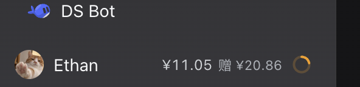

# 客户端增强：余额环与输入预测

面向要改 `plugin/client.js` / `plugin/index.js` 的人。两件事都只发生在 DeepSeek Harness
的浏览器 UI（Web 与 Desktop 共用），不改变会话数据，也不自动发送消息。

---

## 1. 余额环



**位置**：侧栏底部账号行（agent 模式下 DS Bot 返回行下面那一行）的最右端。
默认显示「充值余额 + 赠送金额」（如 `¥12.34 赠 ¥5.00`，赠送为 0 也显示 `赠 ¥0.00`）+ 18px 健康环。
余额数值更新时用 **600ms 缓动滚动**从旧值滚到新值，而不是直接把数字换掉（也不会因为
DOM 变动被反复重绘而闪烁）；`prefers-reduced-motion` 下直接显示最终值。
点击金额/圆环弹出余额详情：充值余额、赠送余额、合计、更新时间。hover / aria-label 也带完整文案。

**数据**：走 DSH 自己的 `remote.account.getBalance()`，和设置 → 账号页同源；
不读 `~/.dsh/.credentials.yaml`、不额外请求平台。

**视觉**：

| 条件 | 环 |
|---|---|
| 余额 ≥ ¥20 | 绿色，接近满环 |
| ¥10 ≤ 余额 < ¥20 | 琥珀色 |
| 余额 < ¥10 | 红色 |
| 未登录 / 无凭据 | 隐藏 |
| 读取失败 | 保留上一次的值与颜色，只把 tooltip 改成「余额读取失败」 |
| 加载中 | 灰色空环 + 呼吸 |

**填充比例**：`min(1, 余额 / ¥50)`，US 钱包按 `$7` 满环；阈值集中在
`createBalanceRing` 的 `RING_CEILING / RING_WARN / RING_LOW`。

**刷新**：挂载时、每 5 分钟、窗口重新聚焦、标签页重新可见、每轮对话结束各一次；
同一时刻只有一个请求在飞。5 分钟是为了不和 DSHNotch.app 自己的轮询一起把平台接口打爆。

**实现**：原生账号菜单占了 `sidebar.settings` 单席，直接替换会把登录/设置/退出一起
换掉；所以环用 DOM 注入：找到 `button[aria-haspopup="menu"]` 里同时有 avatar 和 label
的那一个，在尾部追加一个 `span`。DS Bot 切到 Bot 面（账号菜单被它替换）或侧栏收起时，
环自然不可见；切回 agent 模式后会重新挂上。

---

## 2. 输入框预测

和 Codex 的 composer predictions 同类：**一轮回复结束后**，空输入框里出现一句灰色的
「用户下一句」，按 <kbd>Tab</kbd> 填入（不发送），<kbd>Esc</kbd> 或开始输入就消失。

**触发条件**：

客户端（即时展示）：

- 会话 `running: true → false`；监听放在根级 manager 里，不依赖 composer 组件的挂载时机；
- 回合运行期间用户看过这个会话，或结束时正看着它（composer 挂载会 `POST api/notch/watch`，
  manager 另有 500ms 轮询与 10s 心跳兜底）；
- 输入框为空、没有附件；输入状态回到 `plain`；
- 不是新会话（新会话没有「上一轮」）。

Host（可靠兜底）：

- 插件在 Host 侧监听 `session/event` 的 `turn/end`；只要这个会话被用户看过（watch 过）且是
  根会话，就在回合结束时主动生成并缓存，**完全不依赖客户端此刻显示哪个会话**；
- 客户端切回会话时会 `POST api/notch/predict {cachedOnly:true}` 取缓存；如果 Host 没赶上
  （比如插件刚重载），最近 10 分钟内结束的回合允许现场补生成一次；
- 建议缓存 5 分钟，过期后不会在旧会话里重放。

**生成**（Host）：

1. 客户端 `POST api/notch/predict`，只带 `sessionId`；Host 也可能在 `turn/end` 时主动生成；
2. Host 从会话事件里取最近几轮（用户真实消息 + assistant 文本；图片、文件、工具块、
   运行时上下文都不进）；
3. 用 `ctx.llm.stream()` 调模型：默认优先 `deepseek-account/deepseek-flash`，否则沿用
   会话最后一次 assistant 的 provider/model；
4. 输出清洗：去 Markdown 围栏、角色前缀、首尾引号，压成一行，超长截断；模型回
   `[SKIP]` 就当没有建议；
5. 同一会话同一回合去重缓存，同时最多 3 个模型调用。

**展示**：`conversation.input.overlay` 列表 slot 里一层绝对定位的内容，盖在原
placeholder 上，同时给 composer 卡片加 `data-dsh-prediction` 隐藏原生 placeholder。

- 请求超过 250ms 时先显示 **「AI 填充中…」**（小转圈 + 文字流光动画），
  让等待状态可见；快速跳过/关闭预测时不会闪一下。
- 建议回来后替换成灰字，右侧一个小 `Tab` 键帽提示。
- 建议文本不可选中、不抢焦点、`aria-hidden`；加载态同样不挡输入。

**Tab 填入**：只在建议可见、焦点在 composer、非 IME、无修饰键时接管；调用会话标准
prop `inputActions.setDraft(text)`，填完把焦点还给编辑器。任何失败都静默，不弹 toast。

**取消**：开始输入、加附件、切换会话、提交、回合重新开始、插件卸载都会 abort 在途
请求；Host 侧 `request.signal` 与 8s 超时一起终止模型流。

---

## 3. 配置

在插件 `config`（或 profile 的 patch）里：

```yaml
prediction: true                    # 总开关；false = 客户端不请求、Host 不调模型
predictionProvider: ''              # 留空 = 自动
predictionModel: ''                 # 留空 = 自动
predictionMaxOutputTokens: 96
predictionTimeoutMs: 8000
predictionMaxInputBytes: 12000
```

`provider` 与 `model` 必须同时给或同时留空；只给一个会被 `resolvePredictionRoute`
忽略。想完全不用模型时把 `prediction` 设为 `false` 即可，余额环不受影响。

---

## 4. 成本与隐私

- 余额环：只把用户自己的余额读进浏览器内存；不写日志、不上传。
- 预测：每轮最多一次模型调用，输入是最近几轮对话的文本裁剪（默认 ≤ 12 KB），
  不包含图片、附件内容、工具输出全文。调用发生在用户本机的 Host 进程，走用户已配置的
  模型 provider，不经过第三方服务。
- 预测失败、额度不足、没有路由都只是「没有建议」，不会打断对话，也不会在聊天里留下记录。
- 诊断日志只记状态（例：`预测：已生成（28 字，deepseek-account/deepseek-flash）`），
  不记余额数字、不记建议正文。位置：
  `$(node -e 'process.stdout.write(require("os").tmpdir())')/dsh-notch-plugin.log`
  和 `~/.dsh/notch/client-probe.log`。

---

## 5. 排查

| 现象 | 先看 |
|---|---|
| 没有余额环 | 是否在 agent 模式（DS Bot 的 Bot 模式下账号行被替换）；侧栏是否收起；是否已登录 |
| 环是灰色 | 账号凭据失效、余额接口失败；tooltip 会写「余额读取失败」 |
| 没有预测 | `prediction` 是否为 true；是否刚结束一轮（预测只在回合结束后请求）；输入框是否为空；日志里是否有 `预测：已注册 api/notch/predict` |
| 预测请求 404 | Host 插件没有重载；重启 DSH 或插件管理器里重新启用一次 |
| 预测一直不出现且日志无记录 | 客户端插件没加载到新 bundle：刷新页面 / 重启 DSH |
| Tab 没反应 | 建议是否真的可见；焦点是否在输入框；是否在 IME 组合状态 |

**开发时**：`plugin/index.js` 是链接包源码，HMR 只在一次 profile 重组时替换它；
`plugin/client.js` 改动可以直接热更新。`client-probe.log` 里会有 `apply` / `ring` /
`prediction` 等阶段，可判断插件是否在跑、余额是否读到、预测请求是否发出。
